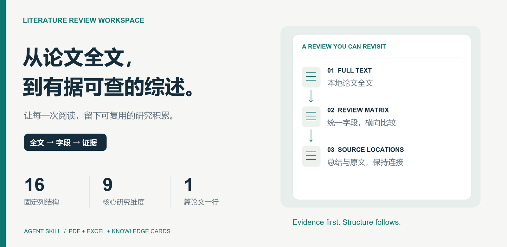
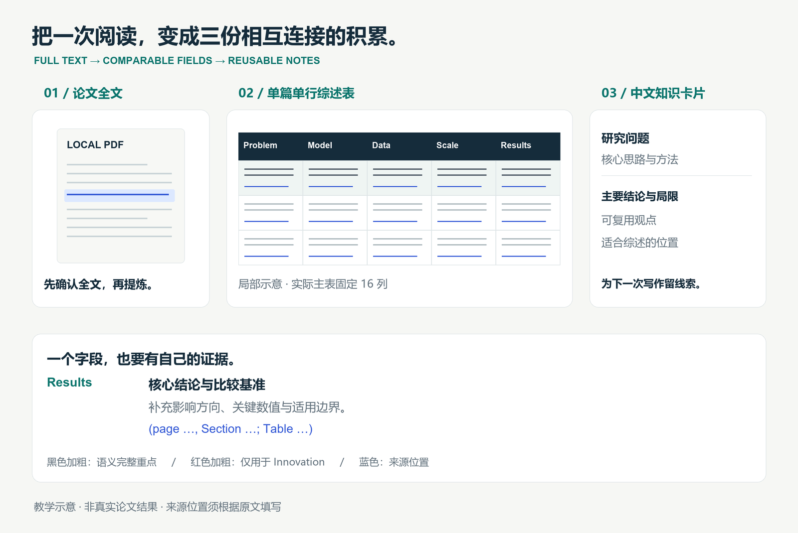

<div align="center">



# Literature Review Workspace

### Read once. Compare clearly. Find the evidence again.

**Local full-text PDFs → a 16-column Excel review matrix → Chinese knowledge cards → source locations.**

[](https://github.com/scoff426-alt/literature-review-workspace/actions/workflows/validate.yml) [](https://github.com/scoff426-alt/literature-review-workspace/stargazers)

[中文](README.md) · [Download Skill](https://github.com/scoff426-alt/literature-review-workspace/archive/refs/heads/main.zip) · [Quick start](#quick-start) · [Workflow rules](SKILL.md) · [Usage guide, Chinese](docs/usage.md)

</div>

## Turn reading into a research resource

A folder of papers and a collection of summaries can still leave you hunting for the same evidence every time you write. This Agent Skill gives an AI assistant a consistent process for organizing papers into comparable review rows, recording source locations, and checking the resulting workbook.

It combines **instructions, templates, and helper scripts**. The scripts initialize a workspace, scan local PDF paths, and validate selected structural and formatting rules. Full-text reading, semantic judgment, workbook authoring, and visual inspection require a capable assistant and appropriate tools.



*Illustrative layout only. Actual content and appearance depend on the source papers, assistant, tools, and user template.*

## What makes the workflow useful

| Need | Approach |
| :--- | :--- |
| Compare papers consistently | One paper per row, with a fixed 16-column schema |
| Keep field meanings distinct | Explicit boundaries for Object/Model, Data/Scale, and Model/Solution |
| Revisit the evidence | Blue source-location lines in all nine substantive fields |
| Make contributions visible | Black bold emphasis for body fields; red bold reserved for Innovation |
| Avoid abstract-only formal entries | Require local full text before formal inclusion |
| Catch problems before batch work | Audit first, then validate a single-paper prototype |

The nine substantive fields are **Problem, Object, Constraints, Model, Solution, Data, Scale, Results, and Innovation**. They follow seven bibliographic and classification columns. Review fields are written in English by default; knowledge cards are written in Chinese. The current final-mode inventory check requires `Language: English`.

## Quick start

Prerequisites: Git, Python 3.10+, and an AI assistant with local file access, PDF reading, and Excel editing tools.

```bash
git clone https://github.com/scoff426-alt/literature-review-workspace.git
cd literature-review-workspace
python -m pip install -r requirements.txt
python scripts/init_workspace.py ./my-review
```

Place full-text PDFs you are authorized to use in `my-review/papers/`, then run:

```bash
python scripts/scan_papers.py ./my-review
```

Ask your assistant:

```text
Read SKILL.md in this repository and its referenced field-writing rules.
Work on ./my-review. Verify the local full-text PDFs and inventory first.
Complete one paper as a prototype: a 16-column Excel row and a Chinese knowledge card.
Check every field against the original PDF and include source locations.
Validate formatting and inspect the workbook visually before proceeding with the batch.
```

After the assistant has created the workbook:

```bash
python scripts/validate_workspace.py ./my-review --workbook ./my-review/文献综述.xlsx --json-report ./my-review/outputs/validation.json --final
```

The workspace is a positional argument. Initialization does **not** create a completed workbook; scanning does **not** download or read papers. MarkItDown is the workflow's first extraction attempt; PDF/OCR and rendering tools may be needed separately. See [usage](docs/usage.md) for dependencies and limitations.

For local Codex installation, place the entire repository at `.codex/skills/literature-review-workspace/` under your user directory, with `SKILL.md` directly inside. Back up existing installations first. Other Agent Skills hosts require their own setup; compatibility has not been validated across hosts.

## Research rigor and its limits

The workflow requires local full text, evidence-based fields, explicit source locations, and human spot checks. Missing PDFs belong in a candidate list, not in a completed formal review.

The validator checks selected workbook structure, rich-text rules, source-line formatting, and inventory conditions. It does **not** verify PDF completeness, factual accuracy, source entailment, actual page locations, originality, or semantic consistency across artifacts. A passing report is not scientific certification.

No quantified speed or factual-accuracy benchmark is claimed. The schema is oriented toward research with explicit models, methods, data, or cases; suitability for other research traditions should be assessed first. This workflow does not itself establish compliance with systematic-review reporting standards.

## License status

No license has been added yet. The repository is currently published for public viewing; licensing terms are to be determined by the maintainer.

## Explore and contribute

- [Workflow instructions](SKILL.md)
- [Field-writing specification](references/jm-template-writing-spec.md)
- [Seven-stage process](references/stage-workflow.md)
- [Knowledge-card template](templates/knowledge-card.template.md)
- [Contributing](CONTRIBUTING.md)

`scripts/` contains current helpers. `legacy/` is historical and is not an entry point. `tests/` checks validator behavior; `evals/` contains evaluation scenarios, not a published model benchmark.

Start with one paper you can verify. If this workflow helps, [give it a Star](https://github.com/scoff426-alt/literature-review-workspace) to find it again, or [share a reproducible issue](https://github.com/scoff426-alt/literature-review-workspace/issues).
