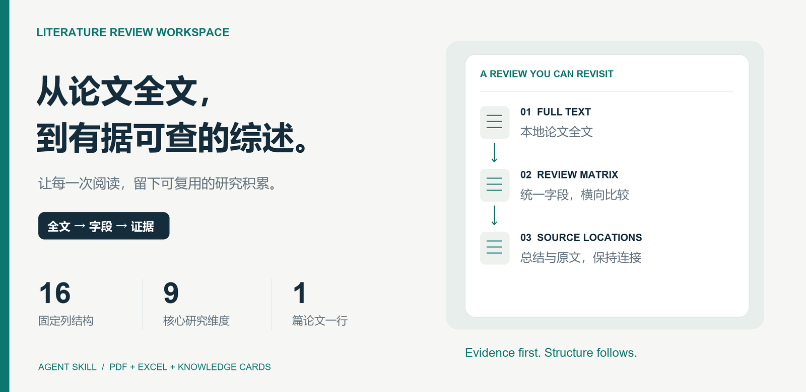
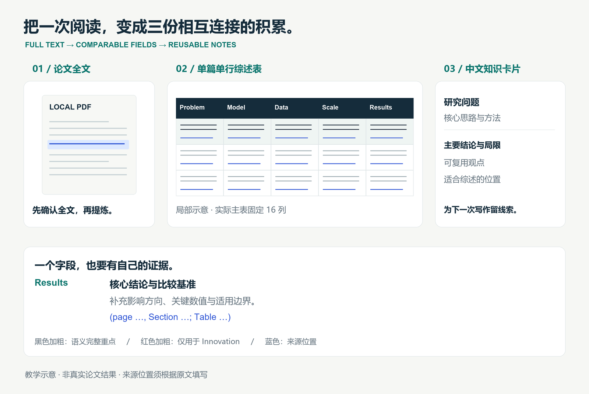

<div align="center">



# Literature Review Workspace

### 读过的论文，别再从头找。

把本地论文全文，整理成 **可比较的 Excel 综述表 × 可复用的中文知识卡片 × 可回查的原文位置**。

给 AI 助手一套有边界、有依据、可检查的文献综述工作流。

[](https://github.com/scoff426-alt/literature-review-workspace/actions/workflows/validate.yml)


[](https://github.com/scoff426-alt/literature-review-workspace/stargazers)

[快速开始](#quick-start) · [看看产出](#outputs) · [质量边界](#quality) · [完整指南](docs/usage.md) · [English](README.en.md)

</div>

---

**写综述时，真正拖慢你的，可能是重新找到那条结论。**

读完一篇论文，有了摘要；读完一批论文，却很难把研究对象、模型、数据与结论放在同一张表里比较。等到写作时，又要重新翻 PDF，确认“这个数字在哪里”“这个结论有哪些前提”。

这个 skill 把这些要求放进同一套流程：**先找全文依据，再按字段组织，最后检查格式与来源。** 每篇论文形成一行综述、一张知识卡片，关键表述带着可以回查的位置。

<a id="outputs"></a>

## 先看你会得到什么



*上图为工作流与格式示意，不是真实论文结果或独立应用界面。实际内容与版式取决于论文、助手能力和用户范本。*

| 产出 | 用在什么时候 |
| :--- | :--- |
| **16 列 Excel 综述表** | 横向比较各篇论文的问题、对象、模型、方法与结论 |
| **中文知识卡片** | 回顾研究逻辑、局限、可复用观点和综述写作位置 |
| **本地 PDF + 来源清单** | 核对哪些论文已有全文，书目信息对应哪个文件 |
| **字段末尾的原文位置** | 从总结回到页码、章节、图表或公式，检查证据 |
| **结构与格式校验报告** | 在交付前发现缺字段、来源行和高亮等问题 |

## 这些细节，决定综述以后还能不能用

| 你可能遇到的问题 | 工作流如何处理 |
| :--- | :--- |
| 每篇都有总结，放在一起却比不了 | **每篇一行、固定 16 列**，统一比较维度 |
| “研究对象”写成目标函数，数据与样本规模混在一起 | 明确 **Object / Model、Data / Scale、Model / Solution** 的字段边界 |
| 总结看起来合理，回头却找不到出处 | 九个正文字段末尾保留 **蓝色原文位置**，要求回到全文核查 |
| 表格满是重点，真正的贡献反而看不见 | 正文用黑色加粗，**红色加粗只留给 Innovation** 中的独立创新点 |
| 只有摘要，也被当作“已读完”的论文 | **缺少本地全文，留在候选清单**，不作为正式综述交付 |
| 一口气改完整批，才发现理解和格式都错了 | **先做一篇原型**，核验并确认后再批量处理 |

### 一张表，把九个问题问清楚

主表固定结构：

```text
日期 · 类别 · 关键词 · authors · journal · Year · Title
Problem · Object · Constraints · Model · Solution · Data · Scale · Results · Innovation
```

| 字段 | 要回答的问题 |
| :--- | :--- |
| **Problem** | 作者解决什么问题？现有研究缺在哪里？ |
| **Object** | 研究、预测、调度或优化的对象是什么？ |
| **Constraints** | 决策受哪些限制、假设和不确定性影响？ |
| **Model** | 模型的核心结构与耦合关系是什么？ |
| **Solution** | 作者怎样求解或应用模型？ |
| **Data** | 数据从哪里来、是什么、含哪些变量、如何生成？ |
| **Scale** | 有多少、多大、多长，实例如何配置？ |
| **Results** | 相对什么基准，有什么方向和数值证据？ |
| **Innovation** | 相对已有研究，真正新增了什么？ |

来源行的格式示例：`(page 4, Section 2.1; page 11, Table 3)`。实际位置必须来自对应论文，不能照抄示例。

<a id="quick-start"></a>

## 从第一篇论文开始

### 1. 下载并准备环境

需要 Git、Python 3.10+，以及具备本地 PDF 阅读和 Excel 编辑能力的 AI 助手。

```bash
git clone https://github.com/scoff426-alt/literature-review-workspace.git
cd literature-review-workspace
python -m pip install -r requirements.txt
python scripts/init_workspace.py ./my-review
```

把你有权使用的全文 PDF 放进 `my-review/papers/`，然后扫描：

```bash
python scripts/scan_papers.py ./my-review
```

### 2. 把这段话交给助手

```text
请读取当前仓库的 SKILL.md，按其中规范处理 ./my-review。
先核对本地 PDF 与 source_inventory.csv，只完成一篇论文作为原型。
生成固定 16 列、每篇一行的 Excel 综述，并同步中文知识卡片。
逐字段回到全文核验，保留来源位置，区分 Data 与 Scale。
完成格式校验与视觉检查，列出仍需我确认的问题，再处理剩余论文。
```

这是一套 **Agent Skill + 辅助脚本**。初始化和扫描命令不会自动读完论文或生成完整综述；这些工作由遵循 `SKILL.md`、具备相应工具的助手执行。

<details>
<summary><b>想作为本地 Codex skill 安装？</b></summary>

将整个仓库目录放入用户的 `.codex/skills/literature-review-workspace/`，并确保该目录下直接有 `SKILL.md`、`references/`、`scripts/` 和 `templates/`。不要只复制一个说明文件。

例如在尚未安装此 skill 时，PowerShell 中可运行：

```powershell
git clone https://github.com/scoff426-alt/literature-review-workspace.git "$HOME/.codex/skills/literature-review-workspace"
```

如果目标目录已有同名 skill，请先备份并比较版本。其他支持 Agent Skills 的助手需按各自安装规则配置；目前没有逐平台兼容性验证。

</details>

### 3. 检查已经生成的工作簿

```bash
python scripts/validate_workspace.py ./my-review --workbook ./my-review/文献综述.xlsx --json-report ./my-review/outputs/validation.json --final
```

正式交付前，修复错误、逐项确认警告，并抽查原文事实与视觉效果。完整步骤见 [使用指南](docs/usage.md)。

<a id="quality"></a>

## 严谨性，来自可检查的过程

**工作流要求：** 正式纳入前取得本地全文；先尝试 MarkItDown 抽取；关键事实回到 PDF 核验；不从摘要补写全文结论；不为了凑数增加创新点；不覆盖唯一原件。

**脚本能检查：** 16 列表头、正文非空、部分富文本规则、来源行格式，以及 inventory 中部分文件和元数据条件。

**仍需要人和助手判断：** 全文是否完整、来源是否支持表述、数字和页码是否准确、分类是否合适、创新是否成立、知识卡片是否与 Excel 一致。

> **校验通过，代表已通过相应结构检查；不等于科学事实已经得到认证。** 本项目未提供效率提升或事实准确率的量化评测，也不保证消除模型幻觉。

当前默认面向**英文论文的结构化整理**：正文字段英文、知识卡片中文。字段设计更贴近有明确模型、方法、数据或案例的研究；迁移到其他研究范式时，先检验字段是否适合。它可支持后续综述写作，但不会仅靠辅助脚本自动生成可投稿的综述正文。

<details>
<summary><b>哪些情况先别批量做？</b></summary>

- 只有摘要或元数据：先补全文，留在候选清单。
- 扫描版、复杂公式或多栏表格抽取不完整：先补充 OCR 或专用 PDF 解析，并核对原页。
- 助手不能保留 Excel 富文本：先补齐工具能力，避免交付后丢失重点和来源颜色。
- 已有复杂工作簿：先只读审计、保存副本、验证单篇原型。
- 需要系统综述的方法学合规：另行制定检索策略、筛选标准和质量评价，本 skill 本身不构成相关认证。

</details>

## 从哪里继续看

| 入口 | 内容 |
| :--- | :--- |
| [SKILL.md](SKILL.md) | 助手执行的主规则与完成标准 |
| [字段写作规范](references/jm-template-writing-spec.md) | 字段边界、内容密度与富文本语义 |
| [七阶段工作流](references/stage-workflow.md) | 从候选筛选到全文核验、交付 |
| [使用指南](docs/usage.md) | 环境、命令、文件结构与能力边界 |
| [知识卡片模板](templates/knowledge-card.template.md) | 中文理解、局限与文献连接 |
| [贡献指南](CONTRIBUTING.md) | 报告问题与改进规则 |

`scripts/` 是当前辅助命令入口。`legacy/` 仅保存历史脚本，不用于当前 16 列工作流。`tests/` 检查校验器规则；`evals/` 提供行为评估用例，不代表已发布模型性能基准。

## 授权状态

本仓库暂未添加许可证，当前先公开展示，授权方式待维护者确定。

## 把下一次回查，变得更轻松

先选一篇手边的论文，跑通“全文 → 综述行 → 知识卡片 → 来源核查”。比起一次填满几十行，一篇经得起回查的原型更适合作为起点。

如果这套方法对你有帮助，欢迎 **[Star 收藏](https://github.com/scoff426-alt/literature-review-workspace)**，下次整理文献时回来用；也欢迎在 **[Issues](https://github.com/scoff426-alt/literature-review-workspace/issues)** 分享字段边界反例和改进建议。

---

<div align="center">

**让每一次阅读，留下能比较、能复用、能回查的研究积累。**

Maintained by [scoff426-alt](https://github.com/scoff426-alt)

</div>
